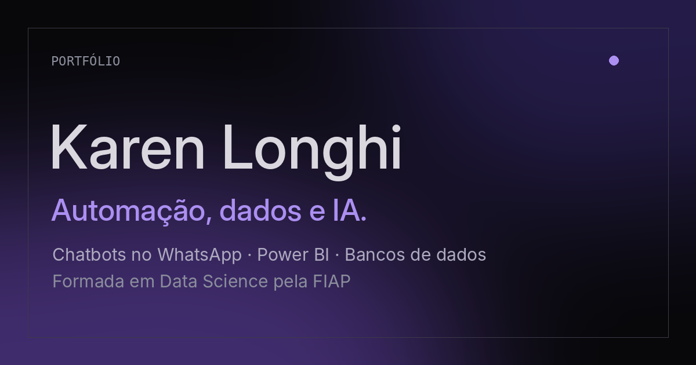

# Karen Longhi · Portfólio

Meu portfólio profissional: projetos, experiência, certificados, stack e contato, em um site de uma página, minimalista e animado.

**Acesse:** https://karenlonghi.github.io



## Sobre

Sou formada em Data Science pela FIAP e trabalho com automação de processos e chatbots no WhatsApp, tratamento de dados, dashboards em Power BI e modelagem e manutenção de bancos de dados. Este site reúne o que já construí e o que estudei.

## O que tem no site

- **Hero** com cartões interativos que se movem com o mouse: regressão linear calculada de verdade, modelo de banco de dados (ER), reconhecimento facial e pipeline de automação.
- **Experiência** na Fieldcorp, com dois casos reais de automação: leitura de hodômetro via WhatsApp com a API da OpenAI e captação de candidatos a motorista.
- **Projetos:** transcrição e análise de ligações de NPS, Voz (assistente de voz) e Moneda (app de finanças pessoais), com filtros por área.
- **Certificados** da FIAP e outros cursos, com nível, código de validação e visualização do documento.
- **Stack** interativa: ao passar o mouse em uma ferramenta, mostra em quais projetos ela foi usada.
- **Console SQL** no contato: digite `help` e consulte os dados do portfólio com `SELECT * FROM projetos;`.
- **Idiomas:** site em português, inglês e espanhol, com troca instantânea.
- **Tema** escuro por padrão, com opção de tema claro.
- **Currículo** em PDF para download.

## Como foi feito

Um único arquivo `index.html`, com HTML, CSS e JavaScript puros

- Animações com CSS e `IntersectionObserver`, respeitando `prefers-reduced-motion`.
- Gráfico de dispersão desenhado em `canvas`, com regressão linear calculada em JavaScript.
- Blocos de tela cheia com `scroll-snap`.
- Textos nos três idiomas em um dicionário no próprio JavaScript.
- Tema e idioma guardados no navegador (`localStorage`).
- Fontes: Inter Tight e JetBrains Mono (Google Fonts).
- Layout responsivo, testado em telas de celular, tablet e computador.

> Este site foi feito com IA, totalmente de graça.

## Estrutura

```
.
├── index.html                 # o site inteiro
├── og.png                     # imagem de prévia do link (WhatsApp, LinkedIn)
├── apple-touch-icon.png       # ícone para a tela inicial do iPhone
├── Curriculo_Karen_Longhi.pdf # currículo
└── README.md
```

## Contato

- E-mail: karennsloo@gmail.com
- LinkedIn: https://www.linkedin.com/in/karenlonghi
- GitHub:
